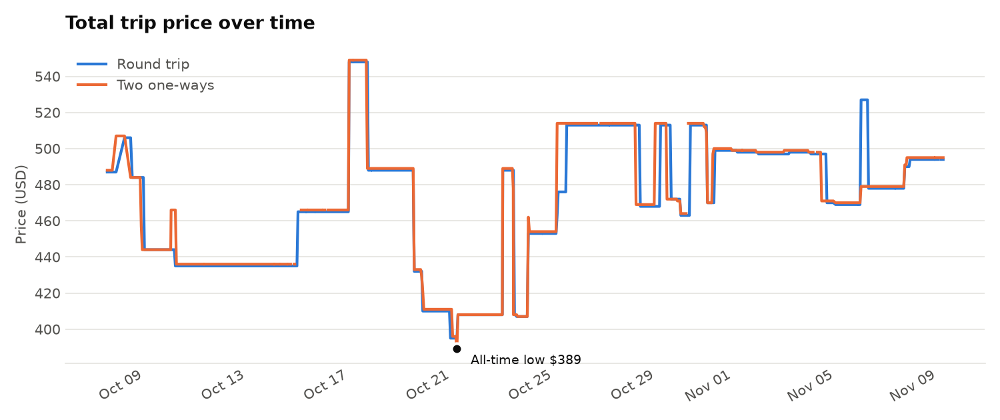
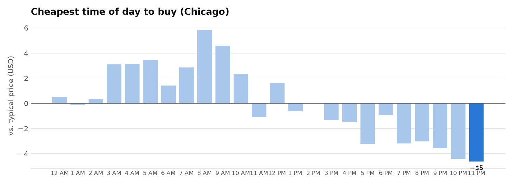
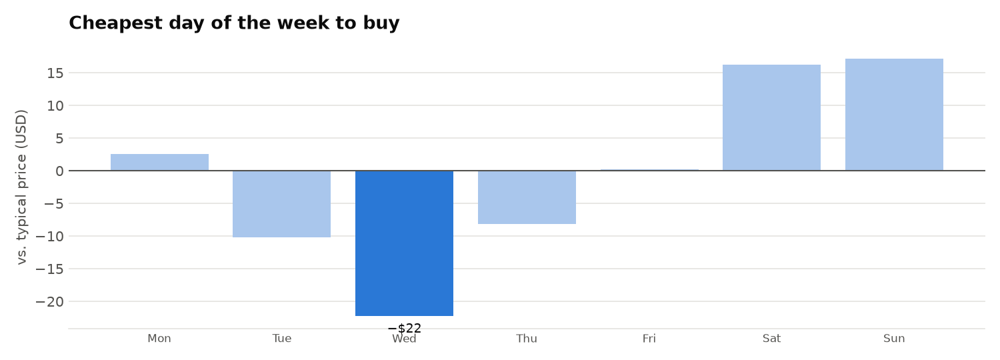

# ✈️ United ORD ⇄ DFW price tracker

**Trip:** Thu Feb 25 2027 ORD→DFW after 4 PM · Sun Feb 28 2027 DFW→ORD after 4 PM · 1 adult, economy (no Basic Economy)
_Updated 2026-11-05 20:28 Chicago time · 813 checks so far · all times Chicago_

## Right now

⚪ **WAIT** — 51% of past checks were cheaper; the low is $389.

| | |
|---|---|
| **Cheapest way to book now** | **$469** as a round trip |
| Round trip | $469 |
| Two one-ways (out + back) | $470 |
| All-time low | $389 on Wed Oct 21, 05 AM |
| All-time high | $548 |
| Average | $466 |
| Days until departure | 112 |

**Cheapest flights right now**

| Search | Price | Flight | Cheapest nonstop |
|---|---|---|---|
| Thu ORD→DFW | $214 | 20:09→23:02 nonstop | $214 |
| Sun DFW→ORD | $256 | 17:20→22:59 1 stop | $264 |
| Round trip (outbound shown) | $469 | 20:09→23:02 nonstop | $469 |

## Price history

## Best time of day

Cheapest hour so far: **11 PM**, about **$5 below** that day's average.

## Best day of the week

Cheapest day so far: **Wednesday**, about **$21 below** that week's average.

| Day | Avg price | vs. typical | Checks |
|---|---|---|---|
| Monday | $476 | +5 | 108 |
| Tuesday | $463 | -8 | 114 |
| Wednesday | $450 | -21 | 112 |
| Thursday | $458 | -10 | 126 |
| Friday | $461 | +0 | 113 |
| Saturday | $477 | +16 | 117 |
| Sunday | $478 | +17 | 118 |

## Daily range (last 14 days)

| Date | Low | High | Avg |
|---|---|---|---|
| Thu Nov 05 | $469 | $469 | $469 |
| Wed Nov 04 | $470 | $498 | $482 |
| Tue Nov 03 | $497 | $498 | $498 |
| Mon Nov 02 | $497 | $497 | $497 |
| Sun Nov 01 | $498 | $499 | $498 |
| Sat Oct 31 | $470 | $499 | $491 |
| Fri Oct 30 | $463 | $513 | $497 |
| Thu Oct 29 | $463 | $513 | $481 |
| Wed Oct 28 | $468 | $513 | $479 |
| Tue Oct 27 | $513 | $514 | $513 |
| Mon Oct 26 | $513 | $513 | $513 |
| Sun Oct 25 | $453 | $513 | $491 |
| Sat Oct 24 | $453 | $454 | $453 |
| Fri Oct 23 | $407 | $488 | $440 |

_Raw data: `data/prices.csv` (one row per search per hour) and `data/options.csv` (every United flight seen)._
