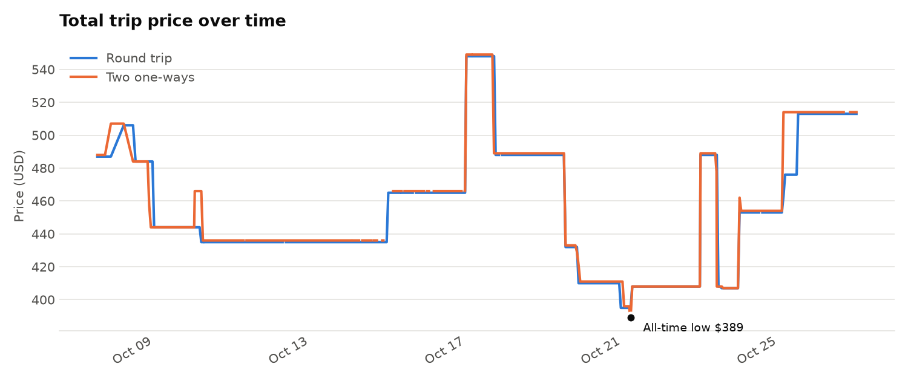
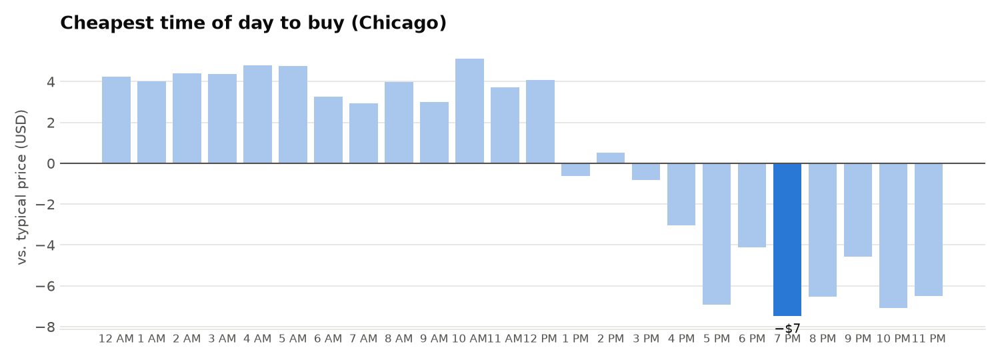
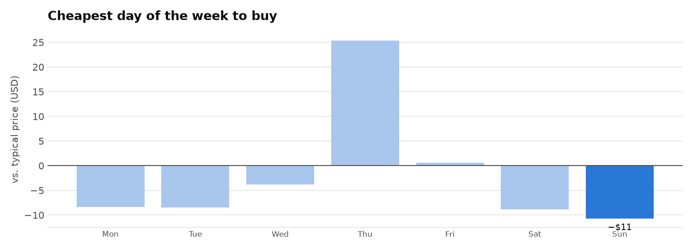

# ✈️ United ORD ⇄ DFW price tracker

**Trip:** Thu Feb 25 2027 ORD→DFW after 4 PM · Sun Feb 28 2027 DFW→ORD after 4 PM · 1 adult, economy (no Basic Economy)
_Updated 2026-10-18 06:08 Chicago time · 284 checks so far · all times Chicago_

## Right now

⚪ **WAIT** — 87% of past checks were cheaper; the low is $435.

| | |
|---|---|
| **Cheapest way to book now** | **$488** as a round trip |
| Round trip | $488 |
| Two one-ways (out + back) | $489 |
| All-time low | $435 on Sat Oct 10, 05 AM |
| All-time high | $548 |
| Average | $456 |
| Days until departure | 130 |

**Cheapest flights right now**

| Search | Price | Flight | Cheapest nonstop |
|---|---|---|---|
| Thu ORD→DFW | $205 | 19:49→22:26 nonstop | $205 |
| Sun DFW→ORD | $284 | 19:55→22:26 nonstop | $284 |
| Round trip (outbound shown) | $488 | 19:49→22:26 nonstop | $488 |

## Price history

## Best time of day

Cheapest hour so far: **10 PM**, about **$8 below** that day's average.

## Best day of the week

Cheapest day so far: **Tuesday**, about **$28 below** that week's average.

| Day | Avg price | vs. typical | Checks |
|---|---|---|---|
| Monday | $435 | -28 | 26 |
| Tuesday | $435 | -28 | 27 |
| Wednesday | $440 | -21 | 32 |
| Thursday | $470 | +13 | 44 |
| Friday | $455 | +0 | 58 |
| Saturday | $483 | +29 | 58 |
| Sunday | $446 | -3 | 37 |

## Daily range (last 14 days)

| Date | Low | High | Avg |
|---|---|---|---|
| Sun Oct 18 | $488 | $488 | $488 |
| Sat Oct 17 | $488 | $548 | $529 |
| Fri Oct 16 | $465 | $465 | $465 |
| Thu Oct 15 | $465 | $466 | $465 |
| Wed Oct 14 | $435 | $435 | $435 |
| Tue Oct 13 | $435 | $435 | $435 |
| Mon Oct 12 | $435 | $436 | $435 |
| Sun Oct 11 | $435 | $435 | $435 |
| Sat Oct 10 | $435 | $444 | $437 |
| Fri Oct 09 | $444 | $444 | $444 |
| Thu Oct 08 | $444 | $506 | $478 |
| Wed Oct 07 | $487 | $487 | $487 |

_Raw data: `data/prices.csv` (one row per search per hour) and `data/options.csv` (every United flight seen)._
